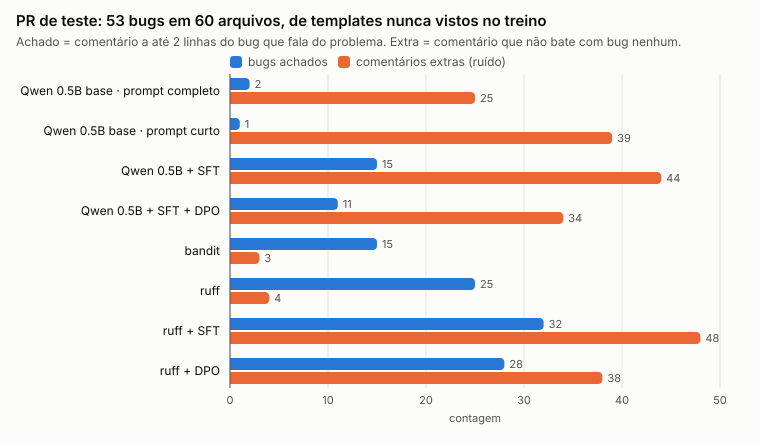

# forja-posttrain

**Pós-treino do modelo base do [Forja](../forja): SFT completo, LoRA, QLoRA e DPO no mesmo modelo, todos medidos pela mesma régua ([forja-evals](../forja-evals)).**

> **Resultado (R1, revisor de PR, tudo em CPU):** um LoRA de 3h36 num Ryzen 5 de notebook leva o Qwen2.5-Coder **0.5B** de **1 para 15 bugs achados em 53** num PR de templates nunca vistos no treino, com **zero** respostas fora do formato (o base quebra quase sempre) e respostas 2 a 4× mais curtas. Sem esquecimento detectável no `forja-seed-v0`. **Mas o `ruff` sozinho acha 25/53 com 4 comentários errados, e o modelo faz 44.** O que o modelo traz é complementar: os 7 bugs que só ele acha são todos semânticos (condição invertida, divisão por vazio, paginação), justamente onde o linter é cego. A configuração útil hoje é **ruff + modelo** (32/53). **O DPO on-policy em cima do SFT não ajudou:** cortou 23% dos comentários errados (44 → 34), mas também 4 acertos (15 → 11), e justamente os semânticos que davam valor ao modelo. O gargalo continua sendo o dado, não o método.

## R1: revisor de PR em CPU (SFT LoRA no 0.5B)

O [forja-review](../forja-review) precisa de um modelo pequeno que ache bug em diff. Com o Gemma 4 26B ele acha 11 de 12 bugs plantados, mas leva de 12 a 22 min por PR; o Qwen 0.5B leva 1 a 2 min e acha 0. Este experimento mede quanto o pós-treino fecha essa distância, **sem GPU**: o resto do plano (E1–E4, abaixo) depende de Kaggle/Colab.

### Resultado



| Revisor | Holdout à mão (4 bugs) | Plantados à mão (8) | **PR de teste (53)** | Extras no teste | Formato quebrado no teste¹ | Tempo no teste² |
| --- | --- | --- | --- | --- | --- | --- |
| Qwen 0.5B base, prompt completo | 0/4³ | 0/8³ | 2/53 | 25 | 57 | 30 min |
| Qwen 0.5B base, prompt curto | 0/4 | 0/8 | 1/53 | 39 | 48 | 11,5 min |
| **Qwen 0.5B + SFT (LoRA)** | 0/4 | **2/8** | **15/53** | 44 | **0** | **9 min** |
| Qwen 0.5B + SFT + DPO | 0/4 | **3/8** | 11/53 | **34** | **0** | 17 min |
| bandit | 1/4 | 1/8 | 15/53 | 3 | — | 3 s |
| ruff (`B,S,BLE,E722,SIM115,PLW`) | **2/4** | 2/8 | **25/53** | **4** | — | 0,3 s |
| **ruff + SFT** | 2/4 | **3/8** | **32/53** | 48 | — | — |
| ruff + DPO | 2/4 | 3/8 | 28/53 | 38 | — | — |
| Gemma 4 26B (teto, do forja-review) | 4/4 | 7/8 | não medido | 0 | 0 | 12–22 min por PR |

¹ Soma de problemas por arquivo (JSON inválido, resposta cortada, linha fora do diff, comentário descritivo).
² Relógio para os 60 arquivos, 8 pedidos em paralelo no forja-serve (fp32, CPU).
³ Medido antes com o prompt v1 (o "completo" atual), no [README do forja-review](../forja-review).

Os números de cada revisor, por PR e por classe, estão em [`results/review-cpu-v0.json`](results/review-cpu-v0.json), gerados por [`scripts/graficos.py`](scripts/graficos.py) a partir dos `--json-out` do forja-review.


**O que os números dizem:**

- **O ganho é do treino, não do prompt.** O base com o mesmo prompt curto acha 1/53. Separar as duas variáveis era obrigatório: o prompt curto foi criado para este treino.
- **O SFT resolveu o formato.** Zero respostas quebradas contra quase todas no base, e respostas curtas e diretas: ~100 tokens por arquivo contra ~170 (base, prompt curto) e ~370 (base, prompt completo). Em relógio, 9 min contra 11,5 e 30.
- **Generaliza, um pouco.** Os 53 bugs vêm de templates que nunca apareceram no treino (split por template, não por exemplo). 15/53 é pouco, mas não é zero, e nos PRs escritos à mão saiu de 0/8 para 2/8 (SQL injection e a paginação com `//`).
- **Mas comenta em tudo.** 44 dos 60 comentários não batem com bug nenhum: ele aprendeu o tom de quem aponta bug mais do que a diferença entre código bugado e corrigido. Parte disso é culpa do dado (abaixo).
- **Linter e modelo enxergam coisas diferentes.** O ruff pega as classes de padrão (SQL montado com string, `shell=True`, default mutável, `requests` sem timeout) com 4 erros em 29 achados. O SFT não acrescenta nada ali, mas acha 7 bugs onde o ruff acha zero: condição invertida, divisão por lista vazia, paginação, recurso sem fechar. Nenhum dos dois pega off-by-one.
- **O DPO deixou o modelo mais calado, não mais certeiro.** Comentários no PR de teste caíram de 60 para 45 e os errados de 44 para 34, mas a proporção de acerto ficou igual (25% → 24%). Ele perdeu exatamente as classes que o ruff não vê: condição invertida 2 → 1, divisão por vazio 2 → 1, paginação 2 → 0. Ganhou 1 em default mutável e 1 em lista modificada iterando, que o ruff já pega. Nos plantados à mão subiu de 2/8 para 3/8; com 8 bugs, isso é 1 caso. Em conjunto com o ruff, ruff + DPO (28/53) fica abaixo de ruff + SFT (32/53).

### Esquecimento: `forja-seed-v0`, base × SFT (mesmo serving)

`forja-evals compare` com bootstrap pareado, ambos em fp32 no forja-serve, temperatura 0:

| Escopo | n | Δ score | IC 95% | Veredito |
| --- | --- | --- | --- | --- |
| geral | 11 | −0,091 | [−0,273; 0] | sem diferença significativa |
| correcao | 4 | −0,250 | [−0,750; 0] | sem diferença significativa (perdeu 1 caso) |
| deteccao_bug | 4 | 0 | [0; 0] | igual |
| recusa | 3 | 0 | [0; 0] | igual |

**✅ Passa no gate.** A saúde melhorou: respostas em loop de 6% para 0%, cortadas por `max_tokens` de 12% para 0%. Ressalva honesta: com 16 casos, o gate pega estrago grande, não diferença fina; o caso de `correcao` perdido é real e está no run.

**DPO:** contra o base, Δ geral −0,091 (IC [−0,364; +0,182]); contra o SFT, Δ 0 (IC [−0,273; +0,273]). Sem regressão nos dois, saúde igual à do SFT (0% em loop, 0% cortadas). ✅ Passa no gate.

### Treino


| | |
| --- | --- |
| Modelo | Qwen2.5-Coder-0.5B-Instruct, fp32 |
| Método | LoRA r=16, α=32, dropout 0,05, todas as camadas lineares: 8,8 M parâmetros treináveis (1,7%) |
| Dados | 402 exemplos (460 gerados, 58 quase-duplicatas removidas), 382 treino / 20 validação |
| Otimização | lr 2e-4 cosseno, warmup 5%, batch 1 × acúmulo 8, 2 épocas = 96 passos, `max_length` 1024 |
| Tempo | 12.979 s (3h36) num Ryzen 5 5625U, ~130 s por passo |
| Custo | ~0,09 kWh (estimativa: ~25 W de pacote × 3,6 h), menos de R$ 0,10 de energia. O custo real é tempo de máquina |
| Perda de validação | 0,455 → 0,157 → 0,075 → 0,062 |

A perda de validação baixa **não** mede generalização: a validação sai do mesmo gerador e dos mesmos templates. Quem mede é o PR de teste (templates reservados) e os PRs escritos à mão.

### Decisões e por quê

- **Dado sintético verificável em vez de destilação.** Destilar do Gemma 26B levaria dias em CPU (7 tok/s, 1.500–4.500 tokens de raciocínio por arquivo). Em vez disso, [`review_sintetico.py`](src/forja_posttrain/review_sintetico.py) gera diffs Python com bugs injetados por template, cada um com a versão corrigida como negativo e o gabarito (linha e classe) conhecido por construção. 34 templates, 12 classes, 14 domínios (pedidos, faturas, alunos...) para variar nomes.
- **Split por template, não por exemplo.** Cada classe tem templates só de treino e um só de teste. Avaliar em exemplos do mesmo template mediria decoreba do template.
- **Contaminação checada dos dois lados.** Contra o `forja-seed-v0` (o `check-data` aborta o treino) e contra os PRs plantados do forja-review (contenção de 5-gramas: 0,03 e 0,085). Dois templates que reproduziam idiomas do holdout (TTL invertido, `descontos={}`) foram reescritos antes do treino.
- **O prompt vem do forja-review.** O gerador chama `forja_review.prompt.messages(..., estilo="curto")`: treino e inferência usam o mesmo texto, byte a byte. O prompt curto (sem checklist e exemplo resolvido) economiza ~550 tokens por chamada; o modelo treinado não precisa das instruções longas.
- **CPU fp32, sem checkpointing.** Medido: uma passada de 1.100 tokens leva ~30 s com ou sem activation checkpointing; sem ele, sobra memória e não há recomputação.
- **Linha de base sem ML na mesma régua.** [`forja-review/examples/linters.py`](../forja-review/examples/linters.py) reconstrói os arquivos a partir do diff, roda ruff/bandit, mantém só achados em linha adicionada (a mesma regra da ancoragem do modelo) e traduz cada regra para a frase da classe que ela detecta (B006 → "argumento padrão mutável"), para o `recall.py` decidir com a mesma checagem de palavra-chave. Sem isso, "15/53" não diria se o modelo vale alguma coisa.

### O que deu errado (e o que mudou)

| Problema | Custo | Correção |
| --- | --- | --- |
| **62% dos exemplos de treino têm bug**; no PR de teste são 38% | explica parte dos 44 extras | fica para a v1 do dataset: proporção controlada e medida |
| O forja-review corta em 15 arquivos por review; a primeira avaliação revisou 15 de 60 | ~40 min refeitos | `FORJA_REVIEW_MAX_ARQUIVOS=100` na avaliação |
| Avaliação com 1 pedido por vez | ~2 h | `FORJA_REVIEW_CONCORRENCIA=8`: o forja-serve faz batching contínuo e gerar é limitado por memória, então 8 custam pouco mais que 1. O seed-v0 continua com 1 por vez para valer a comparação com o baseline |
| Um servidor órfão do base ocupou a porta e os 240 pares do DPO saíram do **base**, não do SFT (o forja-serve responde a qualquer nome de modelo) | 2,7 h | [`gerar_preferencias.py`](scripts/gerar_preferencias.py) confere em `/v1/models` quem está servindo e aborta |
| O DPO caiu duas vezes no passo 3/21 por falta de memória. A causa real era o **disco**: com a RAM disputada (mineração do forja-dados + outros programas), o pagefile cresceu até zerar o C: | ~1 h | activation checkpointing ligado, checkpoint a cada 5 passos, e o DPO rodou sozinho na máquina (10 GB de RAM livre) |
| Depois do DPO, o Smart App Control passou a bloquear o `python.exe` dos venvs com o CPython 3.14 do uv (forja-review, forja-evals); os venvs com o 3.12 do sistema seguiram rodando | 1 avaliação refeita | venv paralelo com 3.12 (`UV_PROJECT_ENVIRONMENT=.venv312 uv sync --python 3.12`), sem mexer na política de segurança |
| Um treino só, uma seed | não sabemos a variância de "15/53" nem se 15 → 11 é ruído | v1: 3 seeds e IC no recall |

### DPO on-policy

O alvo era a precisão. [`gerar_preferencias.py`](scripts/gerar_preferencias.py) faz o SFT revisar 200 arquivos novos (templates de treino, outra seed, nenhum diff já visto), 2 amostras por arquivo a temperatura 0,8, e pontua cada uma com a mesma régua. Quando a pior amostra erra (inventa bug, perde bug, quebra o formato), vira par: **escolhida = gabarito, rejeitada = o erro do próprio modelo**. Resposta perfeita não vira par. O juiz é programático (o gabarito do gerador), o que está declarado no `dataset.yaml`. Config: [`configs/review_dpo_cpu.yaml`](configs/review_dpo_cpu.yaml) (LoRA sobre o SFT mesclado, β 0,1, lr 2e-5, a referência é o SFT com o adapter desligado).

| | |
| --- | --- |
| Pares | 181 de 200 arquivos (400 amostras, 95 perfeitas): comentário extra 67, bug inventado em arquivo limpo 58, bug perdido 47, formato 9. 163 treino / 18 validação |
| Treino | 1 época = 21 passos, 8.022 s (2h14), ~6 min por passo |
| Validação (18 pares nunca vistos) | perda 0,684 → 0,641; prefere o gabarito em 56% → **83%** dos pares; margem 0,02 → 0,11 |

**Por que o modelo aprendeu os pares e mesmo assim não melhorou no PR:**
- **Os pares ensinam a calar.** 125 dos 181 pares (69%) têm como rejeitada um comentário a mais. A lição mais barata é "comente menos", e foi o que ele aprendeu. Um par "bug perdido" pesa igual a um "comentário extra", e havia menos dos primeiros.
- **A escolhida não é do modelo.** Escolhida = gabarito do gerador, num formato que a política nunca amostrou. O DPO puxa para esse texto, mas a margem final (0,11) é pequena: o efeito é mais "afaste-se do que você fez" do que "faça isto".
- **O mesmo problema de dado do SFT.** Templates de treino e as mesmas 12 classes: o DPO não vê nada que o SFT não viu. Ele não cria conhecimento, só redistribui.

O que eu mudaria (v1): balancear os tipos de erro nos pares, usar a melhor amostra do próprio modelo como escolhida quando ela acerta (on-policy dos dois lados), e principalmente treinar com dado real (o [forja-dados](../forja-dados) já minerou 12.943 commits de correção, 3.920 deles reservados para treino pelo split temporal).

### Reproduzir

```bash
uv sync --group dados                                         # o gerador usa o forja-review para montar o prompt
uv run --group dados python scripts/gerar_review.py --n-treino 460 --n-teste 60
HF_HOME=D:/ai-ml-models/hf uv run forja-posttrain train configs/review_lora_cpu.yaml
uv run forja-posttrain merge runs/review-lora-cpu/final D:/ai-ml-models/review-lora-cpu-merged --dtype float32

# no forja-serve e no forja-review
uv run forja-serve serve D:/ai-ml-models/review-lora-cpu-merged --name review-sft --port 8000 --dtype fp32
FORJA_REVIEW_MAX_ARQUIVOS=100 FORJA_REVIEW_CONCORRENCIA=8 uv run forja-review local \
  --diff ../forja-posttrain/data/review-sintetico-v0/teste/pr-teste.diff --model review-sft --prompt curto \
  --json-out results/teste-qwen0.5b-sft-curto.json
uv run python examples/linters.py ../forja-posttrain/data/review-sintetico-v0/teste/pr-teste.diff --ferramenta ruff --json-out results/teste-ruff.json

# esquecimento e gráficos
uv run forja-evals run configs/forja-serve-qwen05-review-sft.yaml   # no forja-evals
uv run python scripts/graficos.py
```

`data/` não é versionado: o dataset sai do gerador com `--seed 0` (o hash de cada diff está no `dataset.yaml`).

## O ponto de partida

O primeiro baseline real do forja-evals: Qwen2.5-Coder-1.5B-Instruct (GGUF Q4_K_M, CPU, prompt de sistema padrão, sem juiz) no `forja-seed-v0`:

| Categoria | Score | O que aconteceu |
| --- | --- | --- |
| correcao | 3/4 | No palíndromo, afirmou que o código já estava correto |
| deteccao_bug | 0/4 | Diagnóstico errado nos quatro |
| recusa | 0/3 | Inventou o retorno de uma função que não viu e um parâmetro que não existe |

**Score geral 0,273.** O modelo base alucina com confiança e não acha bugs. É isso que o pós-treino precisa corrigir: explicar código, achar bugs, sugerir correções, responder sobre APIs e **dizer "não sei" quando não sabe**, tudo em português.

## Papel no sistema

```
forja-pretrain ──► forja-posttrain ──► forja-serve ──► forja-review
                        │    ▲
          checkpoints   ▼    │  pares de preferência (só de datasets uso: treino)
                     forja-evals (a régua)
```

- **Entrada:** o modelo base do [ADR 0001](../forja/docs/adr/0001-modelo-base.md) (Qwen2.5-Coder-1.5B-Instruct; 0.5B como plano B, mesmo tokenizer), um dataset de instrução e pares de preferência (`PreferencePair` do `forja-contracts`, gerados pelo `forja-evals pairs`).
- **Saída:** checkpoints em safetensors (adapter LoRA e modelo mesclado) para o `forja-serve`, cada um com `config.yaml` resolvida, seed, versões e `summary.json`.
- **Régua:** todo checkpoint é servido num endpoint OpenAI-compatível e avaliado pelo forja-evals num conjunto que **nunca** encosta no treino (checagem de contaminação explícita, abaixo).

## Arquitetura

| Etapa | O que faz | Arquivo |
| --- | --- | --- |
| Config | Dataclasses tipadas, YAML + overrides `secao.chave=valor` (mesma convenção do forja-pretrain) | `config.py` |
| Dados de instrução | Schema `InstructionExample` (`messages` ou `prompt`+`resposta`, `categoria`, `origem`, `licenca`), normalização (NFC, LF, espaços) | `data.py` |
| Dedup | Exata (SHA-256 da conversa normalizada) + near-dup (Jaccard de 5-gramas de palavra ≥ 0,8) | `data.py` |
| Contaminação | Contenção de n-gramas de cada exemplo contra cada `EvalCase` do forja-evals: entrada vs. `input` e resposta vs. `referencia`. **Aborta o treino** se passar do limiar | `data.py` |
| Preferências | `PreferencePair.to_trl()` → formato conversacional; recusa pares cujo `dataset.yaml` (ou o de origem, em `gerado_de`) diz `uso: avaliacao` | `data.py` |
| Treino | `SFTTrainer` / `DPOTrainer` do TRL, LoRA via PEFT, QLoRA via bitsandbytes NF4 | `train.py` |
| Mescla | Adapter + base → safetensors para o forja-serve e para ser a política inicial do DPO | `merge.py` |
| Smoke | Qwen2 minúsculo e aleatório + tokenizer BPE treinado na hora: o encanamento inteiro roda em CPU sem baixar nada | `tiny.py` |

```
data/sft.jsonl ─► normaliza ─► dedup ─► contaminação ✗ aborta ─► prompt/completion ─► SFTTrainer ─► final/ (adapter)
                                            ▲                                                          │ merge
                         forja-evals/datasets/*/cases.jsonl                                            ▼
data/preferencias/ ─► proveniência (uso: treino?) ─► contaminação ─► DPOTrainer (política = SFT mesclado) ─► final/
```

## Decisões e trade-offs

- **Loss só na resposta.** O SFT usa o formato *prompt/completion* conversacional do TRL: a loss cai só na última fala do assistant (o prompt de sistema e a pergunta viram `-100`). Não depende de `` no chat template, que o template original do Qwen2.5 não tem.
- **O mesmo prompt de sistema do forja-evals.** O exemplo de treino recebe exatamente o `SYSTEM_PROMPT` que a régua usa na inferência; um teste confere a igualdade com o repo vizinho. Treinar com um prompt e avaliar com outro mediria a diferença de prompt, não o treino. (Pendência: subir o texto para o `forja-contracts`.)
- **Contaminação é erro, não aviso.** Usa *contenção* (fração dos n-gramas do caso de eval presentes no exemplo), não Jaccard: um caso de eval colado dentro de um exemplo maior tem Jaccard baixo, mas contenção 1. Checa também o gabarito (`referencia`) contra as respostas de treino.
- **Proveniência obrigatória para o DPO.** Sem `dataset.yaml` com `uso: treino` e `gerado_de`, não há DPO. É a mesma regra anti-circularidade do `forja-evals pairs`, checada de novo do lado de quem consome.
- **Alvo de hardware: T4 de 16 GB** (Kaggle/Colab gratuito). Consequências: fp16 em vez de bf16 (Turing não tem bf16 nativo), SDPA em vez de flash-attn, activation checkpointing ligado, batch 2 × accum 8. O vocabulário de 152k torna os **logits** o maior consumidor de ativação.
- **SFT completo do 1,5B não cabe no T4** (~24,6 GB só de pesos + gradientes + Adam em fp32). Por isso a comparação justa full vs. LoRA vs. QLoRA roda no **0.5B** (E1), e no 1,5B comparamos LoRA vs. QLoRA (E2). Estimativas de VRAM estão comentadas em cada `configs/*.yaml`; os números medidos vão para `summary.json`.
- **DPO sobre o SFT mesclado, com LoRA.** A referência é o próprio modelo com o adapter desligado: nenhuma segunda cópia na GPU.
- **Mesma régua, mesmo serving.** O baseline 0,273 é de um GGUF Q4_K_M em CPU. Comparar com um checkpoint fp16 servido por vLLM mistura duas variáveis (quantização e pós-treino). Cada linha da tabela de resultados declara o serving; ou o base é reavaliado no mesmo serving, ou o checkpoint é convertido para GGUF Q4_K_M.
- **Esqueleto primeiro.** Este repo é o terreno preparado: o pipeline roda de ponta a ponta em CPU com dados de exemplo; o treino real roda no Kaggle/Colab.

## Como reproduzir

### Local (CPU, só o encanamento)

```bash
uv sync                                   # sem bitsandbytes/wandb: ficam nos extras gpu/track
uv run pytest -q                          # 27 testes, ~30 s em CPU, 100% offline
uv run forja-posttrain check-data configs/smoke.yaml      # dedup + contaminação (exit 1 se contaminado)
uv run forja-posttrain check-prefs configs/smoke.yaml     # proveniência + contaminação dos pares
uv run forja-posttrain train configs/smoke.yaml           # SFT LoRA, 3 passos, modelo minúsculo
uv run forja-posttrain train configs/smoke.yaml method=dpo out_dir=runs/smoke-dpo
```

Os repositórios ficam lado a lado: o `forja-contracts` vem de `../forja/contracts` e as configs apontam a checagem de contaminação para `../forja-evals/datasets/`.

### Kaggle / Colab (T4), passo a passo

1. **Notebook com GPU.** Kaggle: *Settings → Accelerator → GPU T4* e *Internet on*. Colab: *Ambiente de execução → T4*.
2. **Clonar os três repositórios lado a lado** (o contracts e os datasets de avaliação são dependências):
   ```bash
   git clone https://github.com/<usuario>/forja
   git clone https://github.com/<usuario>/forja-evals
   git clone https://github.com/<usuario>/forja-posttrain
   cd forja-posttrain
   ```
3. **Instalar reaproveitando o torch com CUDA que já vem no ambiente** (o `uv.lock` foi resolvido no Windows/CPU; no notebook o pip é mais rápido):
   ```bash
   pip install -q -e ../forja/contracts -e ".[gpu]"     # gpu = bitsandbytes (QLoRA, paged_adamw_8bit)
   ```
4. **Dados.** Suba `sft.jsonl` (e `preferencias/` com `dataset.yaml`) como dataset do Kaggle / Drive e copie para `data/`.
5. **Checar antes de gastar GPU:**
   ```bash
   forja-posttrain check-data configs/sft_lora.yaml
   ```
6. **Treinar** (um método por sessão; o `summary.json` registra VRAM de pico, tempo e versões):
   ```bash
   forja-posttrain train configs/sft_lora.yaml
   forja-posttrain train configs/sft_qlora.yaml
   forja-posttrain train configs/sft_full.yaml           # 0.5B; 1,5B só com 24 GB+
   ```
7. **Mesclar** o adapter para servir (e para ser a política do DPO):
   ```bash
   forja-posttrain merge runs/sft-lora/final runs/sft-lora/merged
   forja-posttrain train configs/dpo.yaml                # dpo.policy_path=runs/sft-lora/merged
   ```
8. **Avaliar com o forja-evals.** Sirva o modelo mesclado num endpoint OpenAI-compatível (ex.: `vllm serve runs/sft-lora/merged --dtype half --port 8000`, ou converta para GGUF e use o `llama-server`, como no baseline) e rode `forja-evals run` com uma config apontando para esse endpoint. Compare com `forja-evals compare` contra o baseline **servido do mesmo jeito**.
9. **Guardar os artefatos.** `runs/<nome>/` (config resolvida, `dados.json`, `summary.json`, `final/`) vai para o output do Kaggle ou para o Hub, com model card linkando o ID da execução do forja-evals.

Cada execução salva em `runs/<nome>/`: `config.yaml` resolvida, `dados.json` (dedup, contaminação, contagem por categoria), `summary.json` (loss, passos, tempo, VRAM, parâmetros treináveis, versões) e `final/` (adapter ou modelo completo, em safetensors).

## Experimentos planejados (uma variável por vez)

Todos com a mesma seed, o mesmo dataset (hash registrado) e avaliados pelo forja-evals num conjunto mantido fora do treino.

| # | Comparação | Modelo | Qualidade por categoria (forja-evals) | Custo (GPU·h) | Tempo | VRAM pico | Regressão geral (lm-evaluation-harness) |
| --- | --- | --- | --- | --- | --- | --- | --- |
| E0 | Base + prompt (baseline) | 1,5B | 0,273 (seed-v0, sem juiz) | — | — | — | referência |
| R1 | Base × SFT LoRA × SFT + DPO, revisor de PR ([acima](#r1-revisor-de-pr-em-cpu-sft-lora-no-05b)) | 0,5B | review: 1 → 15/53 bugs (SFT), 11/53 com menos extras (DPO); seed-v0 sem regressão | 0 (CPU) | 3h36 + 2h14 | — (CPU) | sem regressão no seed-v0 |
| E1 | SFT completo vs. LoRA vs. QLoRA | 0,5B | — | — | — | — | — |
| E2 | LoRA vs. QLoRA | 1,5B | — | — | — | — | — |
| E3 | SFT (LoRA) vs. SFT + DPO | 1,5B | — | — | — | — | — |
| E4 | Rank do LoRA: 8 · 16 · 64 | 1,5B | — | — | — | — | — |

- **Qualidade por categoria:** `explicacao`, `deteccao_bug`, `correcao`, `api`, `recusa`, com IC do bootstrap pareado do forja-evals. A meta mais visível: tirar `recusa` e `deteccao_bug` do zero.
- **Regressão geral:** o pós-treino não pode destruir o que o modelo já sabia. Rodar o `lm-evaluation-harness` antes e depois em tarefas gerais (ex.: ARC, HellaSwag) e de código (HumanEval, MBPP), mais uma tarefa em português.
- **Custo:** GPU·h × preço de referência da GPU; no Kaggle/Colab gratuito o custo é a cota.

## Surpresas de API (transformers 5.23, TRL 1.18, PEFT 0.21)

Verificadas no código instalado, não na documentação:

- `SFTConfig`/`DPOConfig` ligam **bf16 por padrão** (se `fp16` não estiver setado). No T4 isso quebra; aqui a precisão é sempre explícita.
- O TRL liga **activation checkpointing por padrão**, e desde o transformers 5.23 o nome é `activation_checkpointing` (`gradient_checkpointing` virou alias deprecado).
- `warmup_ratio` **não existe mais** no transformers 5: `warmup_steps` aceita fração (< 1) ou número de passos.
- `torch_dtype=` virou `dtype=` no `from_pretrained`; `save_pretrained` não tem mais `safe_serialization` (sempre safetensors).
- Os trainers recebem `processing_class` (não `tokenizer`) e `quantization_config` direto no construtor.
- `DPOConfig` não tem mais `max_prompt_length`; `loss_type` é uma **lista**.
- Com QLoRA, o TRL converte os parâmetros do adapter para **bf16**. No T4 com fp16 isso conflita com o GradScaler; `train.py` devolve os treináveis para fp32 nesse caso.
- O TRL **descarta em silêncio** exemplos cuja resposta some no truncamento; `train.py` falha se o dataset ficar vazio.
- Windows: o Smart App Control bloqueou a DLL do `regex` 2026.11.19 (binário recém-publicado). O `pyproject.toml` restringe `regex<2026`.

## Testes

183 testes, sem rede (`HF_HUB_OFFLINE=1` no `conftest.py`). Os 156 do gerador de review exigem `uv sync --group dados`; sem o grupo, são pulados:

- Config: overrides, chaves desconhecidas, as quatro configs reais carregam, mapeamento de precisão/checkpointing para o `SFTConfig`.
- Dados: schema, normalização, dedup exata e near-dup, contaminação (caso de eval plantado dentro de um exemplo maior, gabarito vazado, dados limpos passam, exemplos não contaminam o `forja-seed-v0`), recusa de pares de `uso: avaliacao` e sem proveniência.
- Gerador de review: todo template compila em todos os domínios e combinações de bugs, cada bug ancora exatamente um comentário, a versão corrigida difere, cada frase do gabarito passa no próprio checador, o split por template é respeitado, a linha do gabarito é a linha do diff, e a pontuação (`pontua`) trata gabarito como perfeito e alucinação como erro.
- Smoke de treino com o Qwen2 minúsculo: SFT LoRA (só o adapter muda, base congelado, loss só na resposta), SFT completo (todos os pesos mudam), DPO LoRA (sem cópia da referência, loss ≈ ln 2 no início), salvar + mesclar (logits do modelo mesclado = logits base + adapter) e treino abortado por contaminação.

## Limitações

- **Só o R1 treinou de verdade, e em CPU.** E1–E4 continuam esperando GPU.
- **R1 é um treino, uma seed, um dataset sintético estreito** (34 templates). A v1 depende de dado real: o [forja-dados](../forja-dados) minera commits de correção de repositórios públicos para isso.
- Os dados em `data/exemplo/` são 9 exemplos e 3 pares escritos à mão: provam o encanamento, não ensinam nada. O dataset do R1 sai do gerador.
- Near-dup O(N²) por Jaccard exato; MinHash + LSH entra na v2, quando o dataset passar de alguns milhares de exemplos.
- A contaminação é léxica (n-gramas). Uma paráfrase de um caso de eval passa; checagem semântica (embeddings) fica para a v2.
- QLoRA não tem caminho em CPU (bitsandbytes 4-bit exige CUDA): no smoke só o LoRA, o SFT completo e o DPO rodam.
- O `uv.lock` foi resolvido no Windows/CPU; no notebook a instalação é por pip, então as versões exatas ficam no `summary.json` de cada execução.
- O prompt de sistema é uma cópia do do forja-evals (um teste guarda a igualdade); o certo é morar no `forja-contracts`.
