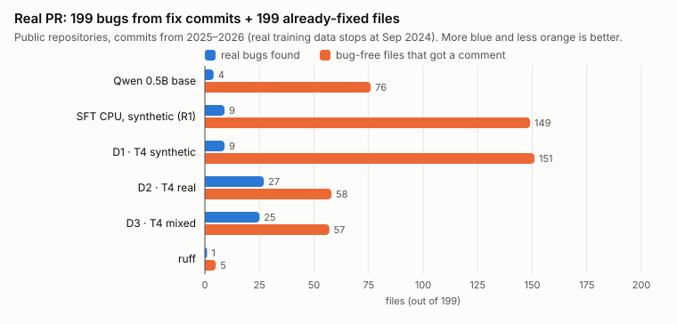
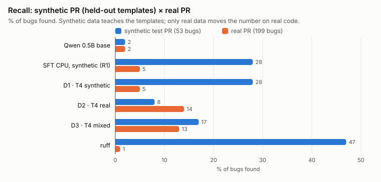
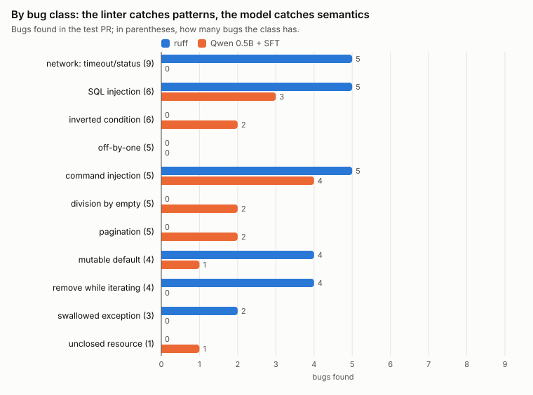
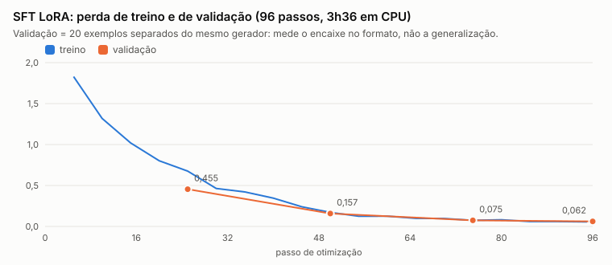

# forja-posttrain

**Post-training for the [Forja](https://github.com/josuekuhim/forja) base model: full SFT, LoRA, QLoRA and DPO on the same model, all measured with the same yardstick ([forja-evals](https://github.com/josuekuhim/forja-evals)).**

> **Result (R2, real data, Kaggle T4 GPU):** the same LoRA on Qwen2.5-Coder **0.5B**, changing only the data. Trained on 1,500 examples from **real bug-fix commits** (from [forja-dados](https://github.com/josuekuhim/forja-dados)), the reviewer finds **27 of 199 real bugs** in a PR built from 2025–2026 commits, against **9** for the model trained on synthetic data. Wrong comments drop from **313 to 89**, and precision rises from 3% to 23%. No forgetting on `forja-seed-v0`. The mixed model (synthetic + real) almost ties on the real PR (25/199) and is the best on the hand-planted bugs (4/8, with no wrong comment). It is still a 0.5B: 14% recall does not make it a reviewer on its own. What this round proves is the direction: **the bottleneck was the data, and changing the data moved recall and precision together.**
>
> **R1 (CPU, synthetic data):** 1 → 15/53 bugs on a synthetic PR of never-seen templates, 100% valid format. But on the real PR the same model finds 9/199 and comments on 3 out of 4 bug-free files: it learned the generator, not code review.

## R2: real data on a Kaggle T4 (D1 synthetic × D2 real × D3 mixed)

R1 ended with a suspicion: the SFT learned the **synthetic generator**, not code review. R2 tests that by changing only the data. Three runs with the R1 recipe (LoRA r16, lr 2e-4, 2 epochs, batch 1 × 8, seed 42), on the same GPU and at the same precision:

| | Training data | Examples (train / val) | Steps | Time on T4 | Peak VRAM |
| --- | --- | --- | --- | --- | --- |
| **D1** | R1 synthetic (`review-sintetico-v0`) | 382 / 20 | 96 | 3.3 min | 3.4 GB |
| **D2** | real (`review-real-v0`, from [forja-dados](https://github.com/josuekuhim/forja-dados)) | 1,425 / 75 | 358 | 31 min | 8.9 GB |
| **D3** | both, concatenated | 1,807 / 95 | 452 | 35 min | 8.9 GB |

`review-real-v0` holds 750 bug-fix commits from 15 public Python repositories with permissive licenses, all before 2024-09-19. Each commit becomes two examples. The **positive** is the file before the fix, and its answer is a comment written by a teacher model (Gemma 4 26B, running on Kaggle) and validated against the line the commit changed. The **negative** is the file after the fix, whose answer is a one-line teacher summary with no comments. The yardstick is `review-eval-v0`, from [forja-evals](https://github.com/josuekuhim/forja-evals): a PR with 199 real bugs from **2025–2026** commits plus the 199 already-fixed files. It never becomes training data.

### Results



| Reviewer | **Real PR: bugs found (199)** | Comments | Wrong | **Precision** | Bug-free files commented on (199) | Synthetic PR (53) | Hand-planted (8) |
| --- | --- | --- | --- | --- | --- | --- | --- |
| Qwen 0.5B base, short prompt | 4 | 155 | 151 | 3% | 76 | 1 | 0 |
| SFT CPU, synthetic (R1) | 9 | 317 | 308 | 3% | 149 | 15 | 2 |
| D1 · T4 synthetic | 9 | 322 | 313 | 3% | 151 | 15 | 2 |
| **D2 · T4 real** | **27** | 116 | **89** | **23%** | 58 | 4 | 0 |
| **D3 · T4 mixed** | 25 | 119 | 94 | 21% | **57** | 9 | **4** (0 wrong) |
| ruff | 1 | 12 | 11 | 8% | 5 | **25** | 2 |



**What the numbers say:**

- **The R1 suspicion was confirmed.** The synthetic models (R1 and D1) find 28% of the synthetic PR's bugs and 5% of the real ones. They comment on 3 out of 4 files that have **no** bug, and only 3% of their comments are right, the same rate as the base model. On real code, synthetic training only taught the model to comment more.
- **Real data moved both ends together.** D2 finds 3× more real bugs (9 → 27) with 3.5× fewer wrong comments (313 → 89). Precision goes from 3% to 23%. Trading recall for precision is usually easy; here both improved at once.
- **Each dataset teaches its own domain.** D2 drops on the synthetic PR (15 → 4). D3 sits in the middle (9/53) and almost ties D2 on the real PR (25 vs. 27, a 2-bug difference out of 199). On the 8 hand-planted bugs, which are semantic and written by a person, D3 is the best of all: 4/8 with no wrong comment, against 2/8 for ruff. **If one model has to be picked, it is D3.**
- **ruff does not work for real bugs.** It finds 1 of 199. Bugs that someone fixed in a commit are rarely the kind a linter catches (string-built SQL, mutable defaults). That is why there is room for the model here.
- **D1 reproduces R1 in 4 minutes.** It gets 15/53, 2/8 and 9/199, the same numbers as the 3h36 fp32 CPU run. Moving from CPU fp32 to T4 fp16 did not change the result, so the differences between D1, D2 and D3 come from the data.

### Forgetting: `forja-seed-v0`, each D × base (same serving)

| Candidate | Δ overall | 95% CI | `no loop` (16 cases) | In a loop | Cut by `max_tokens` | Gate |
| --- | --- | --- | --- | --- | --- | --- |
| D1 synthetic | +0.091 | [−0.182; +0.364] | +0.000 | 6% → 6% | 12% → 0% | ✅ |
| D2 real | +0.091 | [−0.182; +0.364] | +0.062 | 6% → 0% | 12% → 0% | ✅ |
| D3 mixed | +0.000 | [−0.273; +0.273] | +0.062 | 6% → 0% | 12% → 0% | ✅ |

None of the three regresses, and D2 and D3 also lose the base model's loops. The R1 caveat still holds: with 16 cases, the gate catches large damage, not fine differences.

### Decisions and why

- **One variable at a time.** The three configs ([`configs/review_*_lora_t4.yaml`](configs)) differ only in `train_path` (and `max_length`, below). The batch stays at 1 × 8 even though the GPU could take more: a larger batch would add padding and change the recipe. D1 exists only to separate the effect of the machine from the effect of the data.
- **`max_length` 2048 instead of 1024.** The real data has a median of 1,318 tokens, p99 of 1,713 and a max of 2,207. At 1024, most examples would lose their answer to truncation, and TRL **silently drops** examples with no answer left. This was measured before uploading to Kaggle; at 2048, only 1 example is cut.
- **Contrastive pairs are not near-duplicates.** The before and after of the same file are almost identical by construction. Jaccard dedup would have removed half of the negatives, which are exactly the "there is no bug here" signal. [`data.py`](src/forja_posttrain/data.py) now recognizes the pair by its `origem` (`...:file` × `...:file#corrigido`) and only removes exact duplicates. This was also caught before training, with a test in [`tests/test_data.py`](tests/test_data.py).
- **Temporal split, not random.** Training data ends on 2024-09-19, and evaluation starts in January 2025. No evaluation commit can leak into training.
- **A yardstick without keywords on real data.** Real bugs are of class `outro` (other): no phrase describes all of them. A hit counts by line only (± tolerance). To avoid rewarding a model that comments on everything, the yardstick also counts **bug-free files that received a comment**. [`scripts/pontua_t4.py`](scripts/pontua_t4.py) reproduces the R1 numbers on the synthetic PRs before scoring the new ones.
- **Train on GPU, evaluate locally.** The free T4 was used only where the gain is large: 4 min vs. 3h36. Evaluating on the real PR takes ~1.5 h per model on CPU, with prompts of ~1,300 tokens. It ran overnight ([`scripts/avalia_review_t4.sh`](scripts/avalia_review_t4.sh), resumable: it skips what already exists), without spending GPU quota.

### What went wrong (and what changed)

| Problem | Cost | Fix |
| --- | --- | --- |
| On Kaggle, `pip install -e` of `forja-contracts` failed at *installing build dependencies*, with no message | 1 session | [`kaggle_treina.sh`](scripts/kaggle_treina.sh) checks internet access, installs `hatchling` first and uses `--no-build-isolation`; on failure it retries with a full log |
| Kaggle's preinstalled `torchao` 0.10 breaks the import of the pinned peft/transformers. An `\|\| true` in the script let the loop move on to the next run without warning | 1 session | `pip uninstall torchao`, and training became *fail fast*: if the process fails, the script prints the end of the log and stops |
| The real PR at 8 parallel requests with a 10 min timeout: each request took over 10 min and timed out | ~2 h (D1's real PR) | 4 in parallel and a 30 min timeout, only on the real PR |
| Local evaluation competed with everyday use of the machine | 1 interruption | ran overnight, alone |
| `ruff` was not on the `PATH` of the overnight script | 1 step redone by hand | run with the venv's `Scripts/` on the `PATH` |

### Limitations of this round

- **Same repositories.** The split is temporal, but training and evaluation share 15 of the 16 repositories. Part of the gain may be "knowing the repo's style". The next evaluation should use disjoint repositories.
- **One seed per run.** The D2 vs. D3 difference on the real PR (27 × 25) is probably within noise. The difference between synthetic and real (9 × 25–27, 313 × ~90 wrong) is not.
- **The forja-dados labeler is ~80% accurate** (95% CI 65% to 90%, on 40 hand-validated samples). About 20% of the answer key's "bugs" may not be bug fixes, which pulls everyone's recall down equally.
- **The teacher writes the training answers.** D2 learns the style of Gemma 26B, filtered by the line check. It is distillation with verification, not human review.

### Reproduce

```bash
bash scripts/empacota_kaggle.sh                     # zip with forja-posttrain, contracts and the data → Kaggle Dataset
# on Kaggle (T4 GPU, internet on), notebook notebooks/kaggle_review_sft.ipynb: EXPERIMENTOS="sint real misto" bash .../kaggle_treina.sh
# locally, with review-t4-runs.tar.gz extracted:
uv run forja-posttrain merge <runs/review-$x-lora-t4/final> D:/ai-ml-models/review-$x-t4-merged --dtype float32
bash scripts/avalia_review_t4.sh                    # 4 PRs + seed-v0 per model; base, CPU SFT and ruff on the real PR
python scripts/pontua_t4.py && python scripts/graficos_t4.py   # results/review-t4-v0.json and the SVGs
```

## R1: PR reviewer on CPU (SFT LoRA on 0.5B)

[forja-review](https://github.com/josuekuhim/forja-review) needs a small model that finds bugs in a diff. With Gemma 4 26B it finds 11 of 12 planted bugs, but takes 12 to 22 min per PR; Qwen 0.5B takes 1 to 2 min and finds 0. This experiment measures how much post-training closes that gap, **without a GPU**.

### Results


| Reviewer | Hand-written holdout (4 bugs) | Hand-planted (8) | **Test PR (53)** | Extras on test | Broken format on test¹ | Time on test² |
| --- | --- | --- | --- | --- | --- | --- |
| Qwen 0.5B base, full prompt | 0/4³ | 0/8³ | 2/53 | 25 | 57 | 30 min |
| Qwen 0.5B base, short prompt | 0/4 | 0/8 | 1/53 | 39 | 48 | 11.5 min |
| **Qwen 0.5B + SFT (LoRA)** | 0/4 | **2/8** | **15/53** | 44 | **0** | **9 min** |
| Qwen 0.5B + SFT + DPO | 0/4 | **3/8** | 11/53 | **34** | **0** | 17 min |
| bandit | 1/4 | 1/8 | 15/53 | 3 | — | 3 s |
| ruff (`B,S,BLE,E722,SIM115,PLW`) | **2/4** | 2/8 | **25/53** | **4** | — | 0.3 s |
| **ruff + SFT** | 2/4 | **3/8** | **32/53** | 48 | — | — |
| ruff + DPO | 2/4 | 3/8 | 28/53 | 38 | — | — |
| Gemma 4 26B (ceiling, from forja-review) | 4/4 | 7/8 | not measured | 0 | 0 | 12–22 min per PR |

¹ Sum of problems per file (invalid JSON, truncated answer, line outside the diff, descriptive comment).
² Wall clock for the 60 files, 8 parallel requests on forja-serve (fp32, CPU).
³ Measured earlier with the v1 prompt (the current "full" one), in the [forja-review README](https://github.com/josuekuhim/forja-review).

Each reviewer's numbers, per PR and per class, are in [`results/review-cpu-v0.json`](results/review-cpu-v0.json), generated by [`scripts/graficos.py`](scripts/graficos.py) from forja-review's `--json-out` files.



**What the numbers say:**

- **The gain comes from training, not from the prompt.** The base model with the same short prompt finds 1/53. Separating the two variables was mandatory: the short prompt was created for this training.
- **SFT fixed the format.** Zero broken answers against almost all of them for the base model, and short, direct answers: ~100 tokens per file vs. ~170 (base, short prompt) and ~370 (base, full prompt). In wall clock, 9 min vs. 11.5 and 30.
- **It generalizes, a little.** The 53 bugs come from templates that never appeared in training (split by template, not by example). 15/53 is little, but it is not zero, and on the hand-written PRs it went from 0/8 to 2/8 (SQL injection and pagination with `//`).
- **But it comments on everything.** 44 of the 60 comments match no bug: it learned the tone of someone pointing out bugs more than the difference between buggy and fixed code. Part of that is the data's fault (below).
- **Linter and model see different things.** ruff catches the pattern classes (string-built SQL, `shell=True`, mutable defaults, `requests` without a timeout) with 4 errors in 29 findings. The SFT adds nothing there, but finds 7 bugs where ruff finds zero: inverted condition, division by an empty list, pagination, unclosed resource. Neither catches off-by-one.
- **DPO made the model quieter, not more accurate.** Comments on the test PR dropped from 60 to 45 and the wrong ones from 44 to 34, but the hit rate stayed the same (25% → 24%). It lost exactly the classes ruff cannot see: inverted condition 2 → 1, division by empty 2 → 1, pagination 2 → 0. It gained 1 on mutable default and 1 on modifying a list while iterating, which ruff already catches. On the hand-planted PR it went from 2/8 to 3/8; with 8 bugs, that is 1 case. Combined with ruff, ruff + DPO (28/53) is below ruff + SFT (32/53).

### Forgetting: `forja-seed-v0`, base × SFT (same serving)

`forja-evals compare` with paired bootstrap, both fp32 on forja-serve, temperature 0:

| Scope | n | Δ score | 95% CI | Verdict |
| --- | --- | --- | --- | --- |
| overall | 11 | −0.091 | [−0.273; 0] | no significant difference |
| correcao (fix) | 4 | −0.250 | [−0.750; 0] | no significant difference (lost 1 case) |
| deteccao_bug (bug detection) | 4 | 0 | [0; 0] | same |
| recusa (refusal) | 3 | 0 | [0; 0] | same |

**✅ Passes the gate.** Health improved: answers in a loop went from 6% to 0%, answers cut by `max_tokens` from 12% to 0%. Honest caveat: with 16 cases, the gate catches large damage, not fine differences; the lost `correcao` case is real and is in the run.

**DPO:** against the base, Δ overall −0.091 (CI [−0.364; +0.182]); against the SFT, Δ 0 (CI [−0.273; +0.273]). No regression in either, health equal to the SFT's (0% in a loop, 0% cut). ✅ Passes the gate.

### Training



| | |
| --- | --- |
| Model | Qwen2.5-Coder-0.5B-Instruct, fp32 |
| Method | LoRA r=16, α=32, dropout 0.05, all linear layers: 8.8 M trainable parameters (1.7%) |
| Data | 402 examples (460 generated, 58 near-duplicates removed), 382 train / 20 validation |
| Optimization | lr 2e-4 cosine, 5% warmup, batch 1 × accumulation 8, 2 epochs = 96 steps, `max_length` 1024 |
| Time | 12,979 s (3h36) on a laptop Ryzen 5 5625U, ~130 s per step |
| Cost | ~0.09 kWh (estimate: ~25 W package × 3.6 h), less than US$ 0.02 of electricity. The real cost is machine time |
| Validation loss | 0.455 → 0.157 → 0.075 → 0.062 |

The low validation loss does **not** measure generalization: validation comes from the same generator and the same templates. The test PR (held-out templates) and the hand-written PRs measure it.

### Decisions and why

- **Verifiable synthetic data instead of distillation.** Distilling from Gemma 26B would take days on CPU (7 tok/s, 1,500–4,500 reasoning tokens per file). Instead, [`review_sintetico.py`](src/forja_posttrain/review_sintetico.py) generates Python diffs with template-injected bugs, each with the fixed version as a negative and an answer key (line and class) known by construction. 34 templates, 12 classes, 14 domains (orders, invoices, students...) to vary names.
- **Split by template, not by example.** Each class has training-only templates and one test-only template. Evaluating on examples from the same template would measure memorization of the template.
- **Contamination checked on both sides.** Against `forja-seed-v0` (`check-data` aborts training) and against forja-review's planted PRs (5-gram containment: 0.03 and 0.085). Two templates that reproduced holdout idioms (inverted TTL, `descontos={}`) were rewritten before training.
- **The prompt comes from forja-review.** The generator calls `forja_review.prompt.messages(..., estilo="curto")`: training and inference use the same text, byte for byte. The short prompt (no checklist and no solved example) saves ~550 tokens per call; the trained model does not need the long instructions.
- **CPU fp32, no checkpointing.** Measured: a 1,100-token pass takes ~30 s with or without activation checkpointing; without it, memory is left over and there is no recomputation.
- **A non-ML baseline on the same yardstick.** [`forja-review/examples/linters.py`](https://github.com/josuekuhim/forja-review/blob/master/examples/linters.py) rebuilds the files from the diff, runs ruff/bandit, keeps only findings on added lines (the same rule as the model's anchoring) and translates each rule into the phrase for the class it detects (B006 → "mutable default argument"), so `recall.py` decides with the same keyword check. Without it, "15/53" would not say whether the model is worth anything.

### What went wrong (and what changed)

| Problem | Cost | Fix |
| --- | --- | --- |
| **62% of training examples have a bug**; in the test PR it is 38% | explains part of the 44 extras | left for dataset v1: controlled and measured proportion |
| forja-review stops at 15 files per review; the first evaluation reviewed 15 of 60 | ~40 min redone | `FORJA_REVIEW_MAX_ARQUIVOS=100` for evaluation |
| Evaluation with 1 request at a time | ~2 h | `FORJA_REVIEW_CONCORRENCIA=8`: forja-serve does continuous batching and generation is memory-bound, so 8 cost little more than 1. seed-v0 still runs 1 at a time to stay comparable with the baseline |
| An orphaned base-model server held the port, and the 240 DPO pairs came from the **base**, not the SFT (forja-serve answers to any model name) | 2.7 h | [`gerar_preferencias.py`](scripts/gerar_preferencias.py) checks who is serving at `/v1/models` and aborts |
| DPO crashed twice at step 3/21 for lack of memory. The real cause was the **disk**: with RAM contested (forja-dados mining + other programs), the pagefile grew until C: was full | ~1 h | activation checkpointing on, a checkpoint every 5 steps, and DPO ran alone on the machine (10 GB of free RAM) |
| After DPO, Smart App Control started blocking the venvs' `python.exe` built with uv's CPython 3.14 (forja-review, forja-evals); venvs with the system's 3.12 kept running | 1 evaluation redone | parallel venv with 3.12 (`UV_PROJECT_ENVIRONMENT=.venv312 uv sync --python 3.12`), without touching the security policy |
| A single run, one seed | we do not know the variance of "15/53" or whether 15 → 11 is noise | v1: 3 seeds and a CI on recall |

### On-policy DPO

The target was precision. [`gerar_preferencias.py`](scripts/gerar_preferencias.py) has the SFT review 200 new files (training templates, another seed, no diff seen before), 2 samples per file at temperature 0.8, and scores each with the same yardstick. When the worse sample errs (invents a bug, misses a bug, breaks the format), it becomes a pair: **chosen = answer key, rejected = the model's own mistake**. A perfect answer does not become a pair. The judge is programmatic (the generator's answer key), which is declared in `dataset.yaml`. Config: [`configs/review_dpo_cpu.yaml`](configs/review_dpo_cpu.yaml) (LoRA on top of the merged SFT, β 0.1, lr 2e-5, the reference is the SFT with the adapter disabled).

| | |
| --- | --- |
| Pairs | 181 of 200 files (400 samples, 95 perfect): extra comment 67, invented bug in a clean file 58, missed bug 47, format 9. 163 train / 18 validation |
| Training | 1 epoch = 21 steps, 8,022 s (2h14), ~6 min per step |
| Validation (18 unseen pairs) | loss 0.684 → 0.641; prefers the answer key in 56% → **83%** of pairs; margin 0.02 → 0.11 |

**Why the model learned the pairs and still did not improve on the PR:**
- **The pairs teach it to stay quiet.** 125 of the 181 pairs (69%) have an extra comment as the rejected answer. The cheapest lesson is "comment less", and that is what it learned. A "missed bug" pair weighs the same as an "extra comment" pair, and there were fewer of the former.
- **The chosen answer is not the model's.** Chosen = the generator's answer key, in a format the policy never sampled. DPO pulls toward that text, but the final margin (0.11) is small: the effect is more "move away from what you did" than "do this".
- **The same data problem as the SFT.** Training templates and the same 12 classes: DPO sees nothing the SFT did not see. It does not create knowledge, it only redistributes it.

What I would change (v1): balance the error types in the pairs, use the model's own best sample as the chosen answer when it is right (on-policy on both sides), and above all train on real data, which is what R2 did.

### Reproduce

```bash
uv sync --group dados                                         # the generator uses forja-review to build the prompt
uv run --group dados python scripts/gerar_review.py --n-treino 460 --n-teste 60
HF_HOME=D:/ai-ml-models/hf uv run forja-posttrain train configs/review_lora_cpu.yaml
uv run forja-posttrain merge runs/review-lora-cpu/final D:/ai-ml-models/review-lora-cpu-merged --dtype float32

# in forja-serve and forja-review
uv run forja-serve serve D:/ai-ml-models/review-lora-cpu-merged --name review-sft --port 8000 --dtype fp32
FORJA_REVIEW_MAX_ARQUIVOS=100 FORJA_REVIEW_CONCORRENCIA=8 uv run forja-review local \
  --diff ../forja-posttrain/data/review-sintetico-v0/teste/pr-teste.diff --model review-sft --prompt curto \
  --json-out results/teste-qwen0.5b-sft-curto.json
uv run python examples/linters.py ../forja-posttrain/data/review-sintetico-v0/teste/pr-teste.diff --ferramenta ruff --json-out results/teste-ruff.json

# forgetting and charts
uv run forja-evals run configs/forja-serve-qwen05-review-sft.yaml   # in forja-evals
uv run python scripts/graficos.py
```

`data/` is not versioned: the dataset comes out of the generator with `--seed 0` (each diff's hash is in `dataset.yaml`).

## The starting point

The first real forja-evals baseline: Qwen2.5-Coder-1.5B-Instruct (GGUF Q4_K_M, CPU, default system prompt, no judge) on `forja-seed-v0`:

| Category | Score | What happened |
| --- | --- | --- |
| correcao (fix) | 3/4 | On the palindrome, it claimed the code was already correct |
| deteccao_bug (bug detection) | 0/4 | Wrong diagnosis on all four |
| recusa (refusal) | 0/3 | Invented the return value of a function it never saw and a parameter that does not exist |

**Overall score 0.273.** The base model hallucinates confidently and does not find bugs. That is what post-training has to fix: explain code, find bugs, suggest fixes, answer API questions and **say "I don't know" when it doesn't**, all in Portuguese.

## Role in the system

```
forja-pretrain ──► forja-posttrain ──► forja-serve ──► forja-review
                        │    ▲
          checkpoints   ▼    │  preference pairs (only from datasets with uso: treino)
                     forja-evals (the yardstick)
```

- **Input:** the base model from [ADR 0001](https://github.com/josuekuhim/forja/blob/main/docs/adr/0001-modelo-base.md) (Qwen2.5-Coder-1.5B-Instruct as the plan, 0.5B as plan B with the same tokenizer; R1 and R2 use the 0.5B), an instruction dataset and preference pairs (`PreferencePair` from `forja-contracts`, generated by `forja-evals pairs`).
- **Output:** safetensors checkpoints (LoRA adapter and merged model) for `forja-serve`, each with its resolved `config.yaml`, seed, versions and `summary.json`.
- **Yardstick:** every checkpoint is served on an OpenAI-compatible endpoint and evaluated by forja-evals on a set that **never** touches training (explicit contamination check, below).

## Architecture

| Stage | What it does | File |
| --- | --- | --- |
| Config | Typed dataclasses, YAML + `section.key=value` overrides (same convention as forja-pretrain) | `config.py` |
| Instruction data | `InstructionExample` schema (`messages` or `prompt`+`resposta`, `categoria`, `origem`, `licenca`), normalization (NFC, LF, whitespace) | `data.py` |
| Dedup | Exact (SHA-256 of the normalized conversation) + near-dup (Jaccard of word 5-grams ≥ 0.8), sparing contrastive before/after pairs | `data.py` |
| Contamination | n-gram containment of each example against each forja-evals `EvalCase`: input vs. `input` and answer vs. `referencia`. **Aborts training** above the threshold | `data.py` |
| Preferences | `PreferencePair.to_trl()` → conversational format; rejects pairs whose `dataset.yaml` (or the source one, in `gerado_de`) says `uso: avaliacao` | `data.py` |
| Training | TRL's `SFTTrainer` / `DPOTrainer`, LoRA via PEFT, QLoRA via bitsandbytes NF4 | `train.py` |
| Merge | Adapter + base → safetensors for forja-serve and as DPO's initial policy | `merge.py` |
| Smoke | Tiny random Qwen2 + a BPE tokenizer trained on the fly: the whole pipeline runs on CPU without downloading anything | `tiny.py` |

```
data/sft.jsonl ─► normalize ─► dedup ─► contamination ✗ abort ─► prompt/completion ─► SFTTrainer ─► final/ (adapter)
                                            ▲                                                          │ merge
                         forja-evals/datasets/*/cases.jsonl                                            ▼
data/preferencias/ ─► provenance (uso: treino?) ─► contamination ─► DPOTrainer (policy = merged SFT) ─► final/
```

## Decisions and trade-offs

- **Loss on the answer only.** SFT uses TRL's conversational *prompt/completion* format: the loss falls only on the assistant's last turn (the system prompt and the question become `-100`). It does not depend on `` in the chat template, which the original Qwen2.5 template does not have.
- **The same system prompt as forja-evals.** Each training example gets exactly the `SYSTEM_PROMPT` the yardstick uses at inference; a test checks equality with the neighboring repo. Training with one prompt and evaluating with another would measure the prompt difference, not the training. (Pending: move the text into `forja-contracts`.)
- **Contamination is an error, not a warning.** It uses *containment* (fraction of the eval case's n-grams present in the example), not Jaccard: an eval case pasted inside a larger example has a low Jaccard but containment 1. It also checks the answer key (`referencia`) against the training answers.
- **Provenance is mandatory for DPO.** Without a `dataset.yaml` with `uso: treino` and `gerado_de`, there is no DPO. It is the same anti-circularity rule as `forja-evals pairs`, checked again on the consumer side.
- **Hardware target: a 16 GB T4** (free Kaggle/Colab). Consequences: fp16 instead of bf16 (Turing has no native bf16), SDPA instead of flash-attn, activation checkpointing on, batch 2 × accum 8. The 152k vocabulary makes the **logits** the largest activation consumer.
- **Full SFT of the 1.5B does not fit on a T4** (~24.6 GB just for weights + gradients + Adam in fp32). That is why the fair full vs. LoRA vs. QLoRA comparison runs on the **0.5B** (E1), and on the 1.5B we compare LoRA vs. QLoRA (E2). VRAM estimates are commented in each `configs/*.yaml`; measured numbers go to `summary.json`.
- **DPO on top of the merged SFT, with LoRA.** The reference is the model itself with the adapter disabled: no second copy on the GPU.
- **Same yardstick, same serving.** The 0.273 baseline is a GGUF Q4_K_M on CPU. Comparing it with an fp16 checkpoint served by vLLM mixes two variables (quantization and post-training). Each row of a results table declares its serving; R1 and R2 compare everything on forja-serve fp32.
- **Skeleton first.** The pipeline was built to run end to end on CPU with sample data before any real training; R1 trained on CPU, R2 on a Kaggle T4.

## How to reproduce

### Local (CPU, plumbing only)

```bash
uv sync                                   # no bitsandbytes/wandb: they live in the gpu/track extras
uv run pytest -q                          # offline, CPU
uv run forja-posttrain check-data configs/smoke.yaml      # dedup + contamination (exit 1 if contaminated)
uv run forja-posttrain check-prefs configs/smoke.yaml     # pair provenance + contamination
uv run forja-posttrain train configs/smoke.yaml           # SFT LoRA, 3 steps, tiny model
uv run forja-posttrain train configs/smoke.yaml method=dpo out_dir=runs/smoke-dpo
```

The repositories sit side by side: `forja-contracts` comes from `../forja/contracts`, and the configs point the contamination check at `../forja-evals/datasets/`.

### Kaggle / Colab (T4), step by step

1. **A notebook with a GPU.** Kaggle: *Settings → Accelerator → GPU T4* and *Internet on*. Colab: *Runtime → T4*.
2. **Clone the three repositories side by side** (contracts and the evaluation datasets are dependencies):
   ```bash
   git clone https://github.com/josuekuhim/forja
   git clone https://github.com/josuekuhim/forja-evals
   git clone https://github.com/josuekuhim/forja-posttrain
   cd forja-posttrain
   ```
3. **Install, reusing the CUDA torch that ships with the environment** (`uv.lock` was resolved on Windows/CPU; in the notebook pip is faster):
   ```bash
   pip install -q -e ../forja/contracts -e ".[gpu]"     # gpu = bitsandbytes (QLoRA, paged_adamw_8bit)
   ```
   For the review runs, [`scripts/kaggle_treina.sh`](scripts/kaggle_treina.sh) does all of this (including the Kaggle-specific fixes above) from the zip built by `scripts/empacota_kaggle.sh`.
4. **Data.** Upload `sft.jsonl` (and `preferencias/` with `dataset.yaml`) as a Kaggle dataset / to Drive and copy it to `data/`.
5. **Check before spending GPU time:**
   ```bash
   forja-posttrain check-data configs/sft_lora.yaml
   ```
6. **Train** (one method per session; `summary.json` records peak VRAM, time and versions):
   ```bash
   forja-posttrain train configs/sft_lora.yaml
   forja-posttrain train configs/sft_qlora.yaml
   forja-posttrain train configs/sft_full.yaml           # 0.5B; 1.5B only with 24 GB+
   ```
7. **Merge** the adapter for serving (and to be the DPO policy):
   ```bash
   forja-posttrain merge runs/sft-lora/final runs/sft-lora/merged
   forja-posttrain train configs/dpo.yaml                # dpo.policy_path=runs/sft-lora/merged
   ```
8. **Evaluate with forja-evals.** Serve the merged model on an OpenAI-compatible endpoint (forja-serve, as in R1 and R2, or vLLM / `llama-server`) and run `forja-evals run` with a config pointing at it. Compare with `forja-evals compare` against a baseline **served the same way**.
9. **Keep the artifacts.** `runs/<name>/` (resolved config, `dados.json`, `summary.json`, `final/`) goes to the Kaggle output or to the Hub, with a model card linking the forja-evals run ID.

Each run saves to `runs/<name>/`: resolved `config.yaml`, `dados.json` (dedup, contamination, count per category), `summary.json` (loss, steps, time, VRAM, trainable parameters, versions) and `final/` (adapter or full model, in safetensors).

## Experiments (one variable at a time)

All with the same seed, the same dataset (hash recorded) and evaluated by forja-evals on a set kept out of training.

| # | Comparison | Model | Quality (forja-evals / review) | Cost (GPU·h) | Time | Peak VRAM | General regression |
| --- | --- | --- | --- | --- | --- | --- | --- |
| E0 | Base + prompt (baseline) | 1.5B | 0.273 (seed-v0, no judge) | — | — | — | reference |
| R1 | Base × SFT LoRA × SFT + DPO, PR reviewer ([above](#r1-pr-reviewer-on-cpu-sft-lora-on-05b)) | 0.5B | review: 1 → 15/53 bugs (SFT), 11/53 with fewer extras (DPO); no seed-v0 regression | 0 (CPU) | 3h36 + 2h14 | — (CPU) | no seed-v0 regression |
| R2 | Same LoRA, synthetic × real × mixed data, on T4 ([above](#r2-real-data-on-a-kaggle-t4-d1-synthetic--d2-real--d3-mixed)) | 0.5B | real PR: 9 → 27/199 bugs, wrong 313 → 89 (D2); mixed 25/199 and 4/8 planted; no seed-v0 regression | ~1.4 (free Kaggle quota) | 3 min + 31 min + 35 min | 8.9 GB | no seed-v0 regression |
| E1 | Full SFT vs. LoRA vs. QLoRA | 0.5B | — | — | — | — | — |
| E2 | LoRA vs. QLoRA | 1.5B | — | — | — | — | — |
| E3 | SFT (LoRA) vs. SFT + DPO | 1.5B | — | — | — | — | — |
| E4 | LoRA rank: 8 · 16 · 64 | 1.5B | — | — | — | — | — |

- **Quality per category:** `explicacao`, `deteccao_bug`, `correcao`, `api`, `recusa` (explanation, bug detection, fix, API, refusal), with forja-evals' paired-bootstrap CI.
- **General regression:** post-training must not destroy what the model already knew. Run `lm-evaluation-harness` before and after on general tasks (e.g. ARC, HellaSwag) and code tasks (HumanEval, MBPP), plus a Portuguese task.
- **Cost:** GPU·h × the GPU's reference price; on free Kaggle/Colab the cost is quota.

## API surprises (transformers 5.23, TRL 1.18, PEFT 0.21)

Verified in the installed code, not in the docs:

- `SFTConfig`/`DPOConfig` turn on **bf16 by default** (if `fp16` is not set). On a T4 that breaks; here precision is always explicit.
- TRL turns on **activation checkpointing by default**, and since transformers 5.23 its name is `activation_checkpointing` (`gradient_checkpointing` became a deprecated alias).
- `warmup_ratio` **no longer exists** in transformers 5: `warmup_steps` accepts a fraction (< 1) or a number of steps.
- `torch_dtype=` became `dtype=` in `from_pretrained`; `save_pretrained` no longer has `safe_serialization` (always safetensors).
- The trainers take `processing_class` (not `tokenizer`) and `quantization_config` directly in the constructor.
- `DPOConfig` no longer has `max_prompt_length`; `loss_type` is a **list**.
- With QLoRA, TRL converts the adapter parameters to **bf16**. On a T4 with fp16 that conflicts with the GradScaler; `train.py` returns the trainable parameters to fp32 in that case.
- TRL **silently drops** examples whose answer disappears in truncation; `train.py` fails if the dataset ends up empty.
- Windows: Smart App Control blocked the DLL of `regex` 2026.11.19 (a freshly published binary). `pyproject.toml` restricts `regex<2026`.

## Tests

Offline (`HF_HUB_OFFLINE=1` in `conftest.py`). The review-generator tests require `uv sync --group dados`; without the group, they are skipped:

- Config: overrides, unknown keys, the real configs load, mapping of precision/checkpointing to `SFTConfig`.
- Data: schema, normalization, exact and near-dup dedup (including contrastive pairs being kept), contamination (eval case planted inside a larger example, leaked answer key, clean data passes, examples do not contaminate `forja-seed-v0`), rejection of pairs from `uso: avaliacao` and without provenance.
- Review generator: every template compiles in every domain and bug combination, each bug anchors exactly one comment, the fixed version differs, every answer-key phrase passes its own checker, the template split is respected, the answer-key line is the diff line, and scoring (`pontua`) treats the answer key as perfect and hallucination as an error.
- Training smoke with the tiny Qwen2: SFT LoRA (only the adapter changes, base frozen, loss only on the answer), full SFT (all weights change), DPO LoRA (no reference copy, loss ≈ ln 2 at the start), save + merge (merged model logits = base + adapter logits) and training aborted by contamination.

## Limitations

- **R1 (CPU) and R2 (T4) trained for real, only LoRA on the 0.5B.** E1–E4 (QLoRA, full SFT, 1.5B, rank) remain planned.
- **R1 and R2 are one seed per run.** R2 already uses real data from [forja-dados](https://github.com/josuekuhim/forja-dados), but is evaluated on the same repositories as training (temporal split only).
- The data in `data/exemplo/` is 9 examples and 3 hand-written pairs: it proves the plumbing, it teaches nothing.
- Near-dup is O(N²) with exact Jaccard; MinHash + LSH comes in v2, when the dataset passes a few thousand examples.
- Contamination is lexical (n-grams). A paraphrase of an eval case gets through; a semantic check (embeddings) is left for v2.
- QLoRA has no CPU path (bitsandbytes 4-bit requires CUDA): in the smoke test only LoRA, full SFT and DPO run.
- `uv.lock` was resolved on Windows/CPU; in the notebook installation is via pip, so exact versions live in each run's `summary.json`.
- The system prompt is a copy of forja-evals' (a test guards equality); it belongs in `forja-contracts`.
- Code identifiers, file names and dataset fields stay in Portuguese (`deteccao_bug`, `gabarito`, `pontua_t4.py`): the project's target language is Portuguese, and renaming them would break the published datasets and runs.
